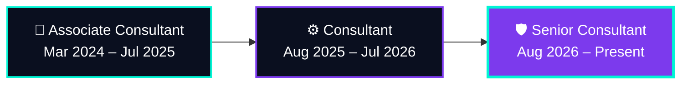

<!-- ============================================================
  BHAWNA SHISHODIA | GitHub Profile README
  Theme: deep navy #0A0F1F + electric teal #00F5D4 + violet #7C3AED
  TODO before pushing: replace YOUR_PORTFOLIO_URL and YOUR_EMAIL
============================================================= -->

<!-- ===================== HEADER BANNER ===================== -->
<div align="center">


<!-- Typing animation -->
<a href="https://github.com/BhawnaShishodia2223">
  
</a>

<br/>

<!-- Badges -->
<a href="https://linkedin.com/in/bhawna-shishodia/"></a>
<a href="YOUR_PORTFOLIO_URL"></a>
<a href="mailto:YOUR_EMAIL"></a>


</div>

<br/>

---

## 👩‍💻 &nbsp;`whoami`

```python
class Bhawna:
    role      = "Senior Consultant, Data Science @ Pravisht Pvt. Ltd."
    based_in  = "Noida, Uttar Pradesh, India 🇮🇳"
    experience = "3+ years"
    focus     = ["Python Backend & APIs", "Enterprise LLM Systems", "Computer Vision"]
    currently = [
        "Overseeing model governance & LLM red-teaming for enterprise AI",
        "Building a Document Management System (workflows + notifications)",
        "Exploring safer, faster, smaller LLMs (LoRA + quantization)",
    ]
    published = "3 research papers • Best Paper Award, MIDAS-2022 (Springer)"
    philosophy = "Ship it reliably. Measure it honestly. Secure it first."
```

---

## ⚡ &nbsp;Impact at a Glance

<div align="center">

| 🧑‍🤝‍🧑 **20+** | ⚡ **40%+** | 🎥 **20+ FPS** | 🩻 **1,000+** | 🐦 **1.8M** | 🌍 **233** |
|:---:|:---:|:---:|:---:|:---:|:---:|
| engineers led | lower inference latency | real-time CV across 3 zones | X-ray scans automated | tweets analyzed | countries covered |

</div>

---

## 🚀 &nbsp;Career Trajectory



<details>
<summary><b>🛡️ Senior Consultant, Data Science</b> &nbsp;<code>Aug 2026 – Present</code></summary>
<br/>

- **Enterprise AI Architecture & Governance:** technical strategy and model governance for enterprise LLM applications; architecture reviews and multi-tenant AI rollouts across cross-functional teams.
- **LLM Red-Teaming & Safety:** adversarial evaluation frameworks and safety guardrails, stress-testing LLM deployments against jailbreaks and prompt injection.

</details>

<details>
<summary><b>⚙️ Consultant, Data Science</b> &nbsp;<code>Aug 2025 – Jul 2026</code></summary>
<br/>

- **Technical Leadership:** led a cross-functional team of 20+ across sprint planning, prioritization, client coordination, and CI/CD delivery.
- **DLP-Guard Framework:** end-to-end Data Loss Prevention, fine-tuning DeBERTa and FLAN-T5 for multi-label classification of PII and adversarial prompts.
- **Efficient Fine-Tuning:** PEFT (LoRA) + 8-bit quantization on TinyLLaMA and MobileBERT for **40%+ lower inference latency** on constrained hardware.
- **Real-Time Spatial Analytics:** YOLOv5 + DeepSORT at **20+ FPS** across 3 exhibition zones, producing dwell times and visitor heatmaps.
- 🏅 *Employee of the Month (2025)*

</details>

<details>
<summary><b>🌱 Associate Consultant, Data Science</b> &nbsp;<code>Mar 2024 – Jul 2025</code></summary>
<br/>

- **Conversational AI & RAG:** multi-turn agents on Botpress with custom JavaScript API hooks for appointment booking and caregiver discovery.
- **Medical Diagnostic Imaging:** YOLO + TensorFlow segmentation across **1,000+ X-ray scans**, computing bone-density matrices and optimal implant insertion angles.
- **Data Engineering & ETL:** Python + SQL pipelines for feature engineering, cleaning, and automated evaluation (mAP, F1, latency).
- 🏅 *Employee of the Quarter (2024)*

</details>

<details>
<summary><b>🔬 NLP & Data Analyst Researcher @ JNU Lab</b> &nbsp;<code>Jun 2022 – Oct 2023</code></summary>
<br/>

- Analyzed **1.8M geotagged tweets from 233 countries** for vaccine-discourse research (GeoCovaxTweets dataset on Harvard Dataverse).
- Topic modeling, sentiment analysis, clustering, and EDA; fine-tuned ELECTRA to **85%+ accuracy** and handled class imbalance via up-sampling.
- Hyperparameter tuning lifted performance by **20%**; produced **50+ visualizations** for publications.

</details>

---

## 🧰 &nbsp;Tech Arsenal

<div align="center">

**Backend & Data**<br/>


**ML, GenAI & Vision**<br/>
<br/><br/>


**MLOps, Cloud & Tools**<br/>
<br/><br/>


</div>

---

## 🗂️ &nbsp;Featured Projects

<!-- TODO: add repo links where the work is public, or delete the "Link" column. -->

| | Project | What it does | Stack |
|:-:|---|---|---|
| 🛡️ | **DLP-Guard Framework** | End-to-end Data Loss Prevention: multi-label classification of PII and adversarial prompts | `DeBERTa` `FLAN-T5` `Hugging Face` |
| 🧪 | **LLM Red-Teaming & Guardrails** | Adversarial evaluation against jailbreaks and prompt injection | `LLM Safety` `Red-Teaming` |
| 📄 | **Document Management System** *(in progress)* | API-driven workflows for assignment, approval, rejection, status tracking, and notifications | `Python` `FastAPI` `PostgreSQL` |
| 🥦 | **Micronutrient Lookup API** | Barcode in, micronutrient data out, with fallback handling for product lookup | `FastAPI` `REST` `Swagger` |
| 💬 | **Healthcare & Care Assistant Chatbot** | Multi-turn RAG agent for appointment booking and caregiver discovery | `Botpress` `RAG` `JavaScript` |
| 🎥 | **Real-Time Person Monitoring** | Tracks 3 exhibition zones at 20+ FPS with dwell-time and heatmap reports | `YOLOv5` `DeepSORT` `OpenCV` |
| 🦷 | **Dental Implant Planning** | Segmentation and angle calculation across 1,000+ X-rays | `YOLO` `TensorFlow` |

---

## 📚 &nbsp;Research & Recognition

- 🏆 **Best Paper Award**, MIDAS-2022 International Conference (Springer), 2023
- 📄 [**From pro, anti to informative and hesitant: An infoveillance study of COVID-19 vaccines and vaccination discourse on Twitter**](https://arxiv.org/abs/2403.09349), arXiv:2403.09349 (2024)
- 📄 **GeoCovaxTweets: A global analysis of COVID-19 vaccines and vaccination discourse on social media**, *Journal of Intelligent & Fuzzy Systems* (2024)
- 📄 **Twitter-based disaster response framework using ELECTRA transformer**, Springer, *Machine Intelligence and Data Science Applications* (2023)
- 🏅 Employee of the Month (2025) • Employee of the Quarter (2024), Pravisht Pvt. Ltd.
- 🎓 B.Sc. Software Development, University of Delhi (CGPA 9.19/10) + NASSCOM Advanced Diploma

---

## 📊 &nbsp;GitHub Analytics

<div align="center">


</div>

<!-- Contribution snake: needs the workflow in .github/workflows/snake.yml (see notes) -->
<div align="center">
  
</div>

---

## 🤝 &nbsp;Let's Build Something

I'm open to conversations about **backend engineering, enterprise LLM systems, AI safety, and computer vision**. Reach out if you'd like to collaborate, or just talk shop.

<div align="center">

<a href="https://linkedin.com/in/bhawna-shishodia/"></a>
<a href="YOUR_PORTFOLIO_URL"></a>
<a href="mailto:YOUR_EMAIL"></a>

<br/><br/>

<sub>⭐ If something here helped you, a star on my repos is always appreciated.</sub>


</div>
